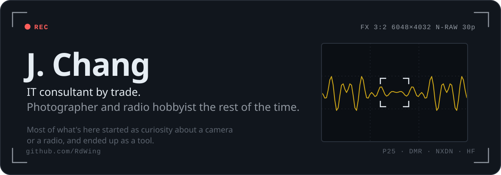
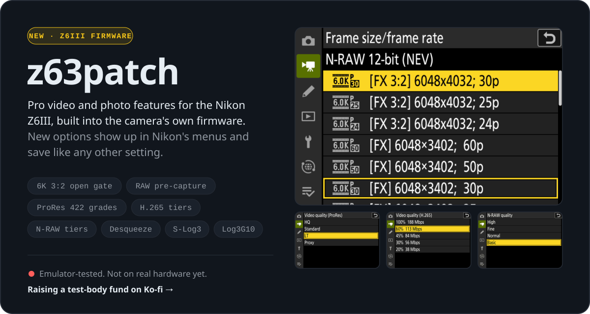
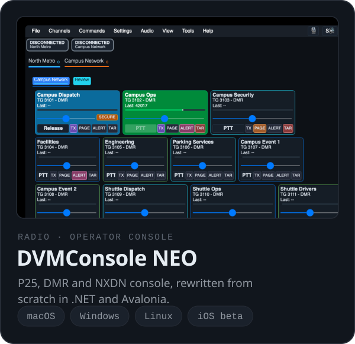
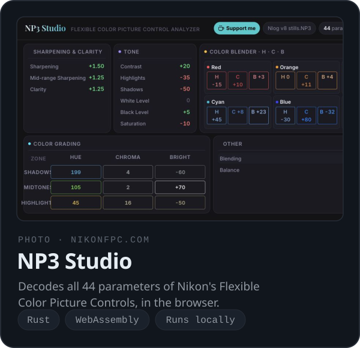
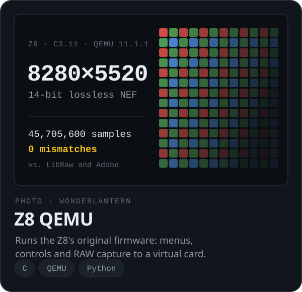
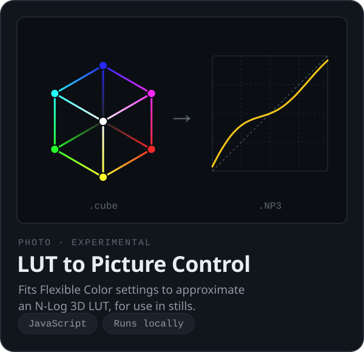

<picture>
  <source media="(prefers-color-scheme: dark)" srcset="assets/hero-dark.svg">
  <source media="(prefers-color-scheme: light)" srcset="assets/hero-light.svg">
  
</picture>

<a href="https://github.com/RdWing/z63patch">
  <picture>
    <source media="(prefers-color-scheme: dark)" srcset="assets/z63patch-dark.svg">
    <source media="(prefers-color-scheme: light)" srcset="assets/z63patch-light.svg">
    
  </picture>
</a>

<a href="https://github.com/RdWing/dvmconsole"><picture><source media="(prefers-color-scheme: dark)" srcset="assets/neo-dark.svg"><source media="(prefers-color-scheme: light)" srcset="assets/neo-light.svg"></picture></a>
<a href="https://www.nikonfpc.com/"><picture><source media="(prefers-color-scheme: dark)" srcset="assets/np3-dark.svg"><source media="(prefers-color-scheme: light)" srcset="assets/np3-light.svg"></picture></a>
<a href="https://github.com/WonderLantern/z8-qemu"><picture><source media="(prefers-color-scheme: dark)" srcset="assets/z8qemu-dark.svg"><source media="(prefers-color-scheme: light)" srcset="assets/z8qemu-light.svg"></picture></a>
<a href="https://rdwing.github.io/nikon-lut-to-np3/"><picture><source media="(prefers-color-scheme: dark)" srcset="assets/lut-dark.svg"><source media="(prefers-color-scheme: light)" srcset="assets/lut-light.svg"></picture></a>

### Now

Getting z63patch off the emulator and onto a real Z6III. I can't risk bricking my only camera, so I'm [raising money for a dedicated test body](https://ko-fi.com/rdwing). Hardware results, failures included, will go in the repo.

### Day job

I run a small IT consulting business working with Microsoft 365, Azure, AWS, networking, identity, security, and automation. Everything above is what happens after hours.

<b>Radio projects and forks</b>

 

- [DVMHost](https://github.com/RdWing/dvmhost) and [FNECore](https://github.com/RdWing/fnecore) — the digital voice network stack NEO connects to
- [KFDtool](https://github.com/RdWing/KFDtool) — P25 keyloading software and hardware
- [NetworkIcom](https://github.com/RdWing/NetworkIcom) — Icom IC-7610 Ethernet control in Swift and SwiftUI
- [P25Clients](https://github.com/RdWing/P25Clients) and [NXDNClients](https://github.com/RdWing/NXDNClients) — gateways and parrots
- [MMDVM_CM](https://github.com/RdWing/MMDVM_CM) — cross-mode conversion
- [anytone-flash-tools](https://github.com/RdWing/anytone-flash-tools) — Anytone radio flash tools
- [OpenHPSDR-wdsp](https://github.com/RdWing/OpenHPSDR-wdsp) — SDR signal processing

<b>More camera work</b>

 

- [Fenestra for the Z6III](https://github.com/RdWing/Fenestra/tree/z63-c201-port) — a port of the Fenestra module runtime to Z6III C2.01, running in the emulator

C# · .NET · Avalonia · C/C++ · Rust · WebAssembly · Python · QEMU · Swift

<i>Mostly I like figuring out how complicated things work and making them easier to use. And occasionally fixing things that probably would have been easier not to take apart in the first place.</i>
